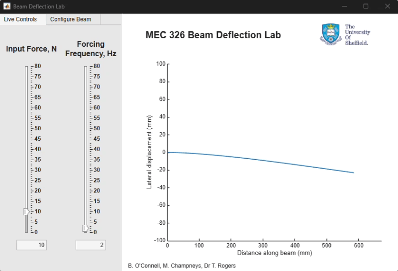

# Cantilever Beam Dynamics (MEC 326) - Online Lab 

A MATLAB app for exploring the dynamics of a simple 1D cantilever beam. Change the forcing and the beam properties, and see how the response and natural frequencies change.



## What it does

The app has two main tabs:

### Forced response

Sliders for the forcing frequency and the amplitude of the applied force.
Watch how the beam's response changes as you sweep the forcing frequency, including as it approaches the natural frequencies.

### Properties and natural frequencies

Change the material properties and beam geometry.
See how these affect the natural frequencies of the beam.

## Getting started
#### Requirements
MATLAB R2021a or later
Control Systems Toolbox 10.10 or later

#### Running the app
Clone or download this repository:
```
repo = gitclone(https://www.github.com/brandonjoconnell/cantilever-dynamics-online-lab)
```

Open MATLAB and set the repository folder as the current folder.

Run the app:

Double-click BeamDeflectionLab.mlapp to open it in App Designer, then press Run, or Type BeamDeflectionLab in the Command Window.

#### Model

The beam is modelled as an Euler-Bernoulli cantilever using modal superposition (first 5 modes, fixed 5% modal damping). A transfer function from a point force at 0.1 m from the clamp to 100 points along the beam is built from the mode shapes and natural frequencies, discretised at 512 Hz, and stepped through time as a difference equation. Changing the beam properties rebuilds the model.

## Notes
Built as a teaching and exploration tool, not for design or validation work.

## Author

Brandon J. O'Connell, University of Sheffield

In collaboration with Max D. Champneys and  Dr Timothy Rogers.

## Licence

MIT 